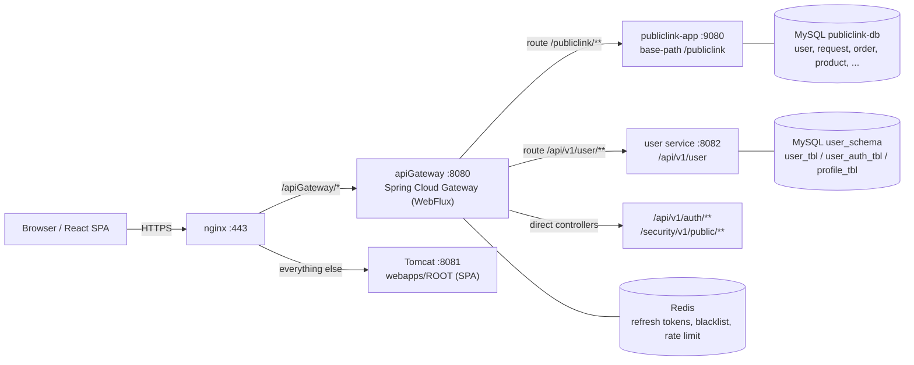
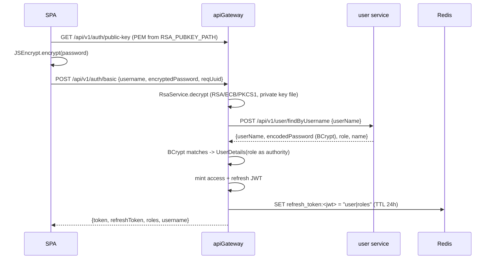
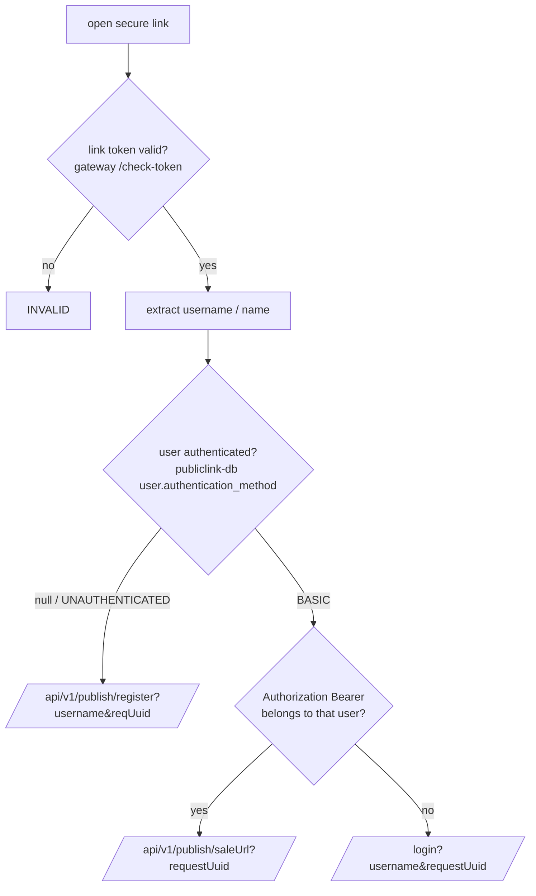
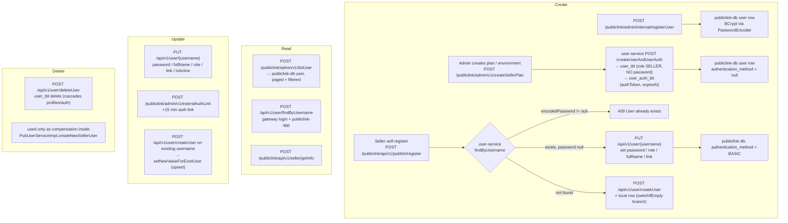
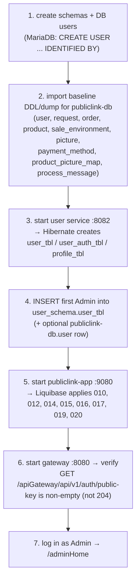

# Authentication & User Flows — back-end-publiclink

Static analysis of the backend: how authentication works, how user CRUD is wired,
whether a first-deployment admin exists, and what the Liquibase setup does (and
does not) create.

> Scope: `back-end-publiclink` as read from source (no runtime verification).
> Everything below is traceable to the files listed in
> [Source of truth](#10-source-of-truth).

---

## 1. Module topology



Two facts to keep in mind:

- **`authen-authorisation/` is dead code.** It is not a `<module>` in the root
  `pom.xml` (modules = `publiclink-app`, `apiGateway`, `adapter`, `user`;
  `data-backup` commented out), so it is never built or deployed. All live
  authentication is `apiGateway` + `user`.
- **`publiclink-app` has no security filter chain.** Its `app_config/SecurityConfig`
  only defines a `PasswordEncoder`; `@EnableWebSecurity`, `@EnableMethodSecurity`
  and every `SecurityFilterChain` block are commented out. Therefore every
  `@PreAuthorize("hasRole('Admin')")` / `hasRole('SELLER')` in `AdminService`,
  `SaleEnvironmentServiceImpl` and `SellerServiceImpl` is **inert**. Authorization
  exists only at the gateway, and only as "authenticated or not".

### Gateway routes (`apiGateway/.../gatewayConfig/GatewayRoutesConfig.java`)

| Path | Target |
|---|---|
| `/publiclink/**` | `publiclink.service.url` (default `http://localhost:9080`) |
| `/api/v1/user/**` | `user.service.url` (default `http://localhost:8082`) |

`/api/v1/auth/**` and `/security/v1/public/**` are served by the gateway itself.
**Note:** `/api/v1/seller/**` is **not routed**, so `user`'s
`SellerAuthenticationController` (findByUsername / updateUserAndUserAuth /
invalidateUserAuth) is unreachable from outside the cluster.

---

## 2. Token families

There are four token types over two HMAC secrets
(`JWT_KEY` → `jwt.secret`, `JWT_URLKEY` → `jwt.secret.url`).

| Token | Minted by | Key / claims | Verified by | TTL | Purpose |
|---|---|---|---|---|---|
| **Access JWT** | gateway `JwtTokenProducer.generateToken` | `jwt.secret`, HS256, `roles[]`, `role`, `name`, `tokenType=access` | gateway `JwtAuthenticationWebFilter` | `jwt.expiration` = 1 h | authenticates API calls |
| **Refresh JWT** | gateway `generateRefreshToken` | `jwt.secret`, `tokenType=refresh`, no roles | gateway `RefreshTokenService` | `jwt.refresh-expiration` = 24 h | rotate access tokens; stored in Redis |
| **Seller auth-link JWT** | gateway `POST /security/v1/public/generateAuthenToken` → `generateTokenByValidTime` | `jwt.secret`, `role`, `name` | gateway `POST /security/v1/public/check-token` (called by publiclink-app) | `link.auth.expired` = 10 h | the link an admin sends to a seller |
| **Public / sale-link JWT** | publiclink-app `LinkService` = `VietQrService` (extends `JwtService`) | `jwt.secret.url`, **raw bytes** | publiclink-app itself (`validateLink`, `validateLinkButNotExpiredValidation`) | `jwt.url.expired` = 48 h | `/publink?token=…` shop page + order API |

Key-derivation asymmetry worth remembering: the gateway does
`Base64.getDecoder().decode(JWT_KEY)`, while publiclink-app's `JwtService.getKey()`
uses `secretKey.getBytes()` raw. Both are self-consistent, so the tokens are simply
not interchangeable across services — which is fine while the gateway only mints
access/refresh/seller-link tokens and publiclink-app only mints sale-link tokens.
`JWT_KEY` must nevertheless be valid Base64 (the `openssl rand -hex 32` output is).

---

## 3. Login flow



Details:

- **Password transport is RSA.** The browser fetches the PEM from
  `GET /api/v1/auth/public-key` (read from `RSA_PUBKEY_PATH`) and encrypts; the
  gateway decrypts with `RSA_PRIVATE_KEY_PATH`. `RsaService` / `UserConfig` resolve
  paths with `java.nio.file.Paths`, so `classpath:` never resolves — keys must be
  absolute filesystem paths (`/opt/publiclink/keys/`). A wrong path makes
  `GET /api/v1/auth/public-key` return **204** and login encryption fail silently.
- **Hashing is BCrypt** (`BCryptPasswordEncoder`), stored only in
  `user_schema.user_tbl.password`.
- **Decryption happens twice** — the gateway decrypts to authenticate, and the user
  service decrypts again in `RsaClient` on create/update.
- **Refresh rotation and revocation** live in `RefreshTokenStorageService`:
  one-time-use refresh tokens (`refresh_token:*`) plus a logout blacklist
  (`token_blacklist:*`), both Redis with TTL. Endpoints:
  `POST /api/v1/auth/refresh`, `POST /api/v1/auth/logout`.
- Access-token authorities are built from the **single** `role` string from
  `user_tbl`, e.g. `Admin` — not `ROLE_ADMIN`.

---

## 4. Per-request authentication at the gateway

`apiGateway/.../gatewayConfig/SecurityConfig.java`:

```java
.pathMatchers(
    "/api/v1/auth/**",
    "/actuator/**",
    "/security/v1/public/**",
    "/api/v1/user/**",
    "/publiclink/api/v1/publish/**")
  .permitAll()
.anyExchange().authenticated()
```

Filter order: `RateLimitingWebFilter` (Redis token bucket, `SecurityWebFiltersOrder.FIRST`)
→ `JwtAuthenticationWebFilter` (`AUTHENTICATION`) → route.

`JwtAuthenticationWebFilter`:

1. requires `Authorization: Bearer …`, validates signature + expiry;
2. rejects `tokenType != access` with 401;
3. extracts `roles` into a `SecurityContext`;
4. forwards `X-User-ID`, `X-Trace-ID`, `X-Auth-Timestamp` downstream — this is how
   `AdminController.notify/send` and `SellerPageController.notifications*` learn
   "who is calling" without any Spring Security in publiclink-app.

### Security gaps (read from code)

- `/api/v1/user/**` is `permitAll()`, exposing `createUser`,
  `createUserAndUserAuth`, `deleteUser` and `PUT /{username}` **unauthenticated**
  through `/apiGateway`.
- There is **no role-based authorization anywhere**: gateway checks authentication
  only, and method security in `publiclink-app` is disabled. Any authenticated
  account (including a Seller obtained via `/publish/register`) can call
  `/publiclink/admin/**`.
- `publiclink-app` binds `127.0.0.1` by default (`SERVER_ADDRESS`), which is the
  only thing preventing direct `:9080` access that would bypass the gateway.

---

## 5. Seller / buyer link-based authentication



Implemented in `publiclink-app/.../service/RedirectionService.java`
(`GET /publiclink/api/v1/publish/link`).

Buyers on the shop page are authenticated purely by the **sale-link token**:
`/publish/publink`, `/publish/order` and `/publish/product/update` all call
`linkService.validateLink(token)` locally inside publiclink-app.

---

## 6. User data model — two user tables

| Store | Table | Owner | Contents |
|---|---|---|---|
| `user_schema` | `user_tbl` | user service (`UserEntity`) | `userId` (UUID), `username`, `password` (BCrypt, **nullable**), `fullName`, `role`, `isActive`, `createdAt`, `version` (`@Version`) |
| `user_schema` | `user_auth_tbl` | `UserAuthEntity` | `authId`, `authToken`, `expireAt`, `isActive`, `extendedNum`, `user_id` FK |
| `user_schema` | `profile_tbl` | `ProfileEntity` | `profileLink`, `profileType`, `user_id` FK |
| `publiclink-db` | `user` | publiclink-app (`User`) | `user_id`, `user_name`, `temp_password`, `name`, `link`, `type` (`SELLER`/`BUYER`), `authentication_method` (`BASIC`/`UNAUTHENTICATED`), `created_at` |

Role vocabulary is inconsistent across layers:

| Layer | Values |
|---|---|
| user service `UserRole` enum | `ROLE_ADMIN`, `ROLE_SELLER`, `ROLE_BUYER` — **not enforced**, `createUser` stores whatever string arrives |
| publiclink-app `RoleEnum` | `ADMIN("Admin")`, `USER("User")`, `SELLER("Seller")`, `BUYER("Buyer")`, `BADMINTON_ADMIN("Badminton_Admin")` |
| publiclink-app `UserType` | `SELLER`, `BUYER` |
| frontend | `normalizeRole()` strips `ROLE_` + lowercases; `role == "admin"` → `/adminHome`, `seller` → `/sellerHome` |

Practical consequence: seed the first admin with `role = 'Admin'`.

---

## 7. User CRUD flows



| Operation | Public URL (via gateway) | Handler | Notes |
|---|---|---|---|
| Create admin/internal | `POST /apiGateway/publiclink/admin/internal/registerUser` | `SuperAdminController` → `UserServiceImpl.saveAdminUser` | writes **only** `publiclink-db.user`; no `user_tbl` row → **cannot log in** |
| Create seller account | internal `POST /api/v1/user/createUserAndUserAuth` | `UserServiceImpl.doCreateUserAuth` | creates `user_tbl` with `role=SELLER` and **no password**, plus an `user_auth_tbl` row |
| Seller register | `POST /apiGateway/publiclink/api/v1/publish/register` | `PubUserServiceImpl.registerNewSeller` | dual-write `user_tbl` + `publiclink-db.user`; compensating `deleteUser` if the local write fails |
| List | `POST /apiGateway/publiclink/admin/v1/listUser` | `PubUserServiceImpl.listUser` → `publiclink-db.user` | filter by username/name/email/role, sort by userName |
| Find | `POST /apiGateway/api/v1/user/findByUsername` | `UserServiceImpl.findByUserName` | public; returns the BCrypt hash to the caller |
| Update | `PUT /apiGateway/api/v1/user/{username}` | `UserServiceImpl.doUpdateUser` | username immutable; re-hashes password only if it differs |
| Upsert | `POST /apiGateway/api/v1/user/createUser` | `setNewValueForExistUser` | same username → update |
| Delete | `POST /apiGateway/api/v1/user/deleteUser` | `UserServiceImpl.doDeleteUser` | resolves **by username**; `UserRemoveRequest.userId` is `@Deprecated` and the compensation code stuffs the username into it |
| Auth-token lifecycle | `/api/v1/seller/...` | `SellerAuthenticationController` | **not routed** by the gateway → unreachable externally |
| Password echo | — | `PasswordMasker` | responses show `****abcd` (all but the last 3 chars masked) |

### Caveats in the seller-registration path (verify before relying on it)

1. `PubUserServiceImpl.toUserRegisterRequest(...)` — the **create** branch — never
   sets `encryptedPassword`; only `toUserRegisterRequestForUpdate(...)` does. A
   brand-new account would be written with `password = NULL` and could not
   authenticate. The intended path is clearly the "exists with null password →
   update" branch, which is why admin provisioning pre-creates a password-less
   `user_tbl` row.
2. `OperatedUserClient.findUserByUsername` uses `retrieve()` without `onStatus`, so
   a **404** from user service raises `WebClientResponseException` and skips
   `switchIfEmpty` — the create branch is only reached when user service answers
   200 with an empty body.
3. The gateway's `permitAll()` on `/api/v1/user/**` (see §4) means all of the above
   write endpoints are reachable without a token.

---

## 8. First deployment: no root user

**There is no root / super-admin user, no seed data, and no working bootstrap path
on a fresh install.**

1. **No seed rows anywhere.** The only `INSERT` in the changelog tree is pricing
   data (`changeset-019-create-business-rule.sql`, 7 `business_rule` rows).
   `sql/query.sql` is just ``use `publiclink-db`;``. No `CommandLineRunner` /
   `ApplicationRunner` / `@PostConstruct` seeding exists.
2. **The only admin-creation endpoint is behind the gate it would bootstrap.**
   `SuperAdminController` is `POST /publiclink/admin/internal/registerUser`, and the
   gateway only permits `/publiclink/api/v1/publish/**` under that prefix —
   `/publiclink/admin/**` requires `authenticated()`. Chicken-and-egg.
3. **`setup-server.sh` provisions OS/nginx/systemd/RSA keys only** — zero `mysql` /
   `CREATE DATABASE` statements. Database and DB users are manual steps.
4. **The only unauthenticated user-creating path creates a Seller**, not an admin:
   `/publiclink/api/v1/publish/register` is `permitAll()` but hard-codes
   `role = SELLER` and (caveat 1 above) forwards no password.

### Bootstrap the first admin by hand

Run against **`user_schema`** (the store the login flow reads), *after* the user
service has started once so Hibernate created `user_tbl`:

```sql
-- generate the BCrypt hash first, either way:
--   htpasswd -bnBC 10 "" 'YourStrongPassword' | tr -d ':\n'
--   python -c "import bcrypt;print(bcrypt.hashpw(b'YourStrongPassword', bcrypt.gensalt(rounds=10)).decode())"

INSERT INTO user_tbl (user_id, username, password, full_name, role, is_active, created_at, version)
VALUES (UUID(), 'admin', '$2a$10$....your.bcrypt.hash....', 'Administrator', 'Admin', 1, NOW(), 0);
```

- `role` must be **`Admin`** (or `ROLE_ADMIN`): publiclink-app's `ADMIN("Admin")`
  and the SPA's `primaryRole === "admin" → /adminHome` both depend on the spelling.
- `version` is a `@Version long` — insert `0`.
- Optionally mirror the row in `publiclink-db` so `/admin/v1/listUser` shows the
  admin:

```sql
INSERT INTO user (user_id, user_name, name, link, type, created_at, authentication_method)
VALUES (UUID(), 'admin', 'Administrator', NULL, 'Admin', NOW(), 'BASIC');
```

---

## 9. Liquibase — enabled, but there is no baseline

`publiclink-app` enables Liquibase in dev/qa/prod:

```properties
spring.liquibase.enabled=true
spring.liquibase.change-log=classpath:db/changelog/db.changelog-master.xml
```

`db.changelog-master.xml` currently includes only **incremental** changesets:

| Included | Script | Effect | Needs existing |
|---|---|---|---|
| 010 | `changeset-010-update-order.sql` | `ALTER TABLE order ADD amount/unit/note` | `order` |
| 012 | `changeset-012-create-pricing.sql` | `CREATE TABLE pricing` (+FK) | `request` |
| 014 | `changeset-014-update-user.sql` | `ALTER TABLE user DROP has_authentication; ADD authentication_method` | **`user`** |
| 015 | `changeset-015-add-picture-data.sql` | `ALTER TABLE picture ADD data` | `picture` |
| 016 | `changeset-016-add-will-ended-at.sql` | `ALTER TABLE sale_environment ADD will_ended_at` | `sale_environment` |
| 017 | `changeset-017-create-notification.sql` | `CREATE TABLE notification`, `notification_recipient` | — |
| 019 | `changeset-019-create-business-rule.sql` | `CREATE TABLE business_rule` + 7 seed rows | — |
| 020 | `changeset-020-add-start-end-time.sql` | `ALTER TABLE request ADD start_time/end_time` | `request` |

Commented out in the master: **001** (`Request`), **002** (`user` + request
columns), 004, 005, 006, 007, 008, 009, 011, and 018 (owned by `data-backup`).

Consequences:

- **`publiclink-db` cannot be created from scratch by Liquibase.** On an empty
  schema it fails at changeset **010** (`ALTER TABLE order`), and there is **no
  create-changeset** for the base tables `user / request / order / product /
  sale_environment / picture / payment_method / product_picture_map /
  process_message`. They came from the commented-out 001–009 plus manual DDL.
  `application.properties` sets no `ddl-auto` for `publiclink-app`, so Hibernate
  defaults to `none` and will not create them either. **A baseline DDL/dump is
  required before first start.**
- **`user_schema` is not Liquibase at all:**
  `user/src/main/resources/application.properties` sets
  `spring.jpa.hibernate.ddl-auto=update`, so `user_tbl`, `user_auth_tbl` and
  `profile_tbl` are generated by Hibernate on first boot.
- **`data-backup` has its own changelog** against `backup_meta` (changesets
  001–004: `backup_trigger`, `backup_file`, `otp_session`, `backup_watermark`),
  plus `changeset-018-create-backup-otp.sql` living in the publiclink-app folder
  (`CREATE TABLE IF NOT EXISTS backup_otp`), currently **not wired into the master**.
  The module is commented out of the reactor, so none of it runs unless re-enabled.

### Recommended first-boot order



To make this reproducible, the clean fix is a `changeset-000-baseline.sql` (or
`.xml`) creating the base tables and included **first** in the master — today the
first-boot story is "restore a dump".

---

## 10. Source of truth

| Concern | File |
|---|---|
| Routing | `apiGateway/src/main/java/.../gatewayConfig/GatewayRoutesConfig.java` |
| Permitted paths, CORS | `apiGateway/src/main/java/.../gatewayConfig/SecurityConfig.java` |
| JWT mint/verify | `apiGateway/src/main/java/.../authentication/JwtTokenProducer.java` |
| Login / refresh / logout | `apiGateway/src/main/java/.../authentication/{AuthenticationController,impl/AuthenticationServiceImpl,RefreshTokenService,RefreshTokenStorageService,RsaService}.java` |
| Request-time auth | `apiGateway/src/main/java/.../filter/JwtAuthenticationWebFilter.java`, `RateLimitingWebFilter.java` |
| User lookup for login | `apiGateway/src/main/java/.../service/ApiUserService.java`, `integration/UserClient.java` |
| Link-token service | `apiGateway/src/main/java/.../integration/SecurityCheckPublicController.java`, `service/impl/SecurityCheckServiceImpl.java` |
| User CRUD | `user/src/main/java/.../controller/{UserController,SellerAuthenticationController}.java`, `service/{UserServiceImpl,UserAuthenServiceImpl,RsaClient,PasswordMasker}.java` |
| User entities | `user/src/main/java/.../entity/{UserEntity,UserAuthEntity,ProfileEntity}.java` |
| Seller onboarding | `publiclink-app/src/main/java/.../user/impl/PubUserServiceImpl.java`, `controller/{PageController,SuperAdminController}.java` |
| Redirection logic | `publiclink-app/src/main/java/.../service/RedirectionService.java` |
| App-side JWT (sale link) | `publiclink-app/src/main/java/.../service/generating/JwtService.java`, `service/VietQrService.java` |
| Liquibase | `publiclink-app/src/main/resources/db/changelog/**` |
| Datasource / Liquibase / RSA config | `publiclink-app/src/main/resources/application-{dev,qa,prod}.properties`, `user/src/main/resources/application.properties`, `apiGateway/src/main/resources/application.properties` |
